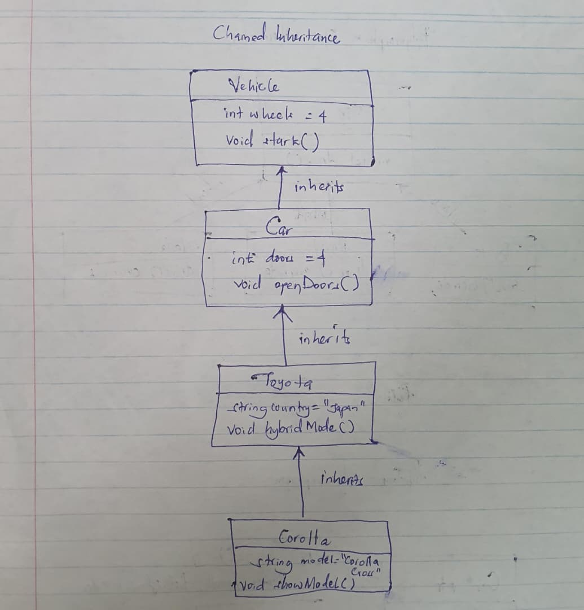
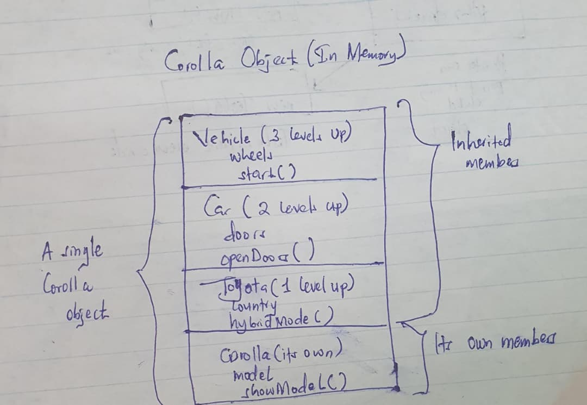

# Task 1: Chained (Multilevel) Inheritance

**File:** `inheritance.cpp`
**Example:** Vehicle -> Car -> Toyota -> Corolla

---

## 1. Objective

Show chained inheritance in C++, where each class inherits from the one above it, forming a chain.

## 2. Concept

In chained inheritance, a class inherits from a parent, and that parent inherits from its own parent. The last class in the chain gets the members of every class above it.

## 3. Class Structure

| Level | Class   | Inherits from | Data member       | Function        |
|-------|---------|---------------|-------------------|-----------------|
| 1     | Vehicle | none          | `wheels`          | `start()`       |
| 2     | Car     | Vehicle       | `doors`           | `openDoors()`   |
| 3     | Toyota  | Car           | `country`         | `hybridMode()`  |
| 4     | Corolla | Toyota        | `model`           | `showModel()`   |

## 4. What a Corolla Object Can Use

| Member           | Comes from |
|------------------|------------|
| `start()`, `wheels`      | Vehicle (3 levels up) |
| `openDoors()`, `doors`   | Car (2 levels up) |
| `hybridMode()`, `country`| Toyota (1 level up) |
| `showModel()`, `model`   | Corolla (its own) |

## 5. How to Compile and Run

```
g++ inheritance.cpp -o inheritance
./inheritance
```

## 6. Output

```
--- Car object ---
Vehicle: engine started
Car: 4 doors opened

--- Corolla object ---
Vehicle: engine started
Car: 4 doors opened
Toyota: hybrid mode ON
Corolla: model is Corolla Cross

Wheels: 4
Doors: 4
Made in: Japan
```

## 7. How the Code Works

1. `Car myCar;` can call `start()` (inherited from Vehicle) and `openDoors()` (its own).
2. `Corolla myCorolla;` can call functions from all four classes.
3. Inherited data members (`wheels`, `doors`, `country`) are read directly from the Corolla object.

---

## 8. Hand-Drawn Illustration: Inheritance Chain

Draw the four classes as boxes, one above the other. Put each class's own members inside its box. Draw arrows from child to parent and label them "inherits".



## 9. Hand-Drawn Illustration: Corolla Object

Draw a Corolla object and show which members it gets from each level.


