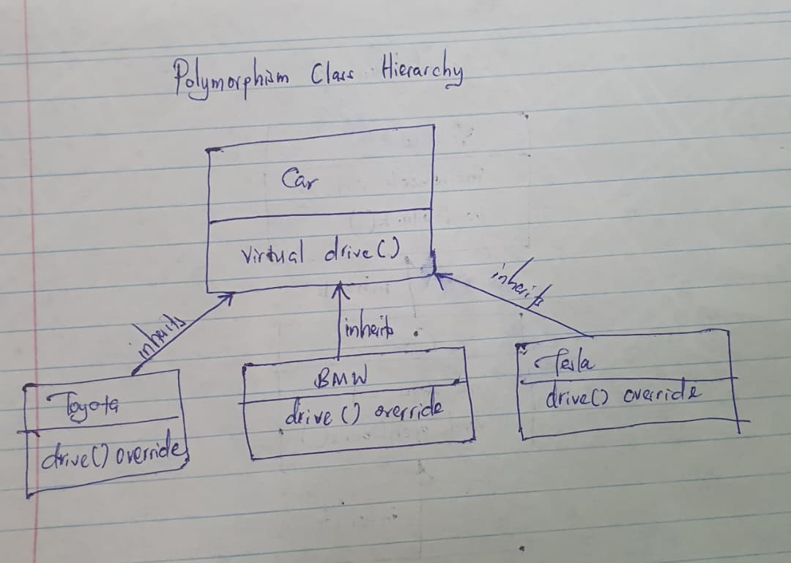
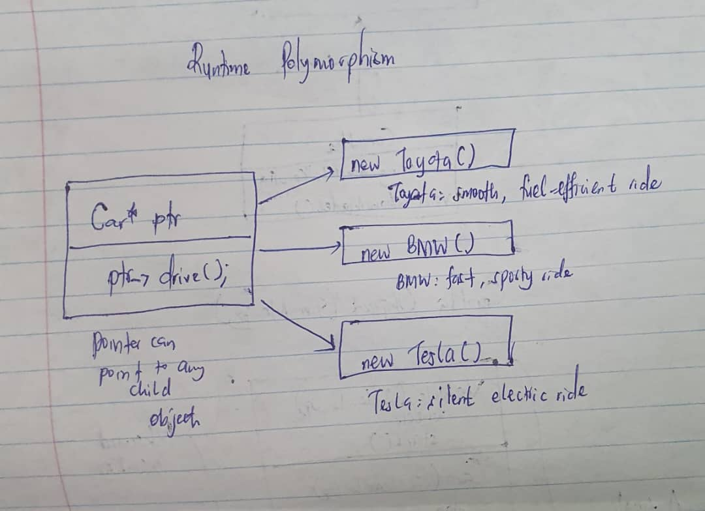

# Task 2: Polymorphism

**File:** `polymorphism.cpp`
**Example:** Car (parent) -> Toyota, BMW, Tesla (children)

---

## 1. Objective

Show runtime polymorphism in C++: one function call that behaves differently depending on the real object.

## 2. Concept

A parent class declares a **virtual** function. Each child class **overrides** it with its own version. When the function is called through a parent pointer or reference, C++ decides at runtime which version to run, based on the object it points to.

## 3. Class Structure

| Class  | Inherits from | `drive()` behaviour                |
|--------|---------------|------------------------------------|
| Car    | none (parent) | `virtual`: default version         |
| Toyota | Car           | `override`: smooth, fuel-efficient |
| BMW    | Car           | `override`: fast, sporty           |
| Tesla  | Car           | `override`: silent electric        |

## 4. Key Points

1. `virtual` in the parent tells C++ to pick the version at runtime.
2. `override` in each child marks that it replaces the parent's version.
3. A `Car*` pointer (or `Car&` reference) can point to any child object.
4. `virtual ~Car() {}` makes `delete` on a parent pointer clean up the child correctly.

## 5. How to Compile and Run

```
g++ polymorphism.cpp -o polymorphism
./polymorphism
```

## 6. Output

```
Toyota: smooth, fuel-efficient ride
BMW: fast, sporty ride
Tesla: silent electric ride

Using a reference:
BMW: fast, sporty ride
```

## 7. How the Code Works

1. `Car* c1 = new Toyota();` creates a Toyota and stores it in a Car pointer. `c2` and `c3` do the same with BMW and Tesla.
2. `c1->drive()`, `c2->drive()` and `c3->drive()` are the same call but print different results.
3. `Car& ref = myBmw;` shows the same behaviour through a reference.
4. `delete` frees the memory of each object.

---

## 8. Hand-Drawn Illustration: Class Hierarchy

Draw `Car` at the top with `virtual drive()`, and the three children below it, each with its own `drive()` marked `override`.



## 9. Hand-Drawn Illustration: Runtime Behaviour

Draw one `Car*` pointer with the call `ptr->drive()`. Draw arrows from it to the Toyota, BMW and Tesla objects, and write each object's output next to it.


